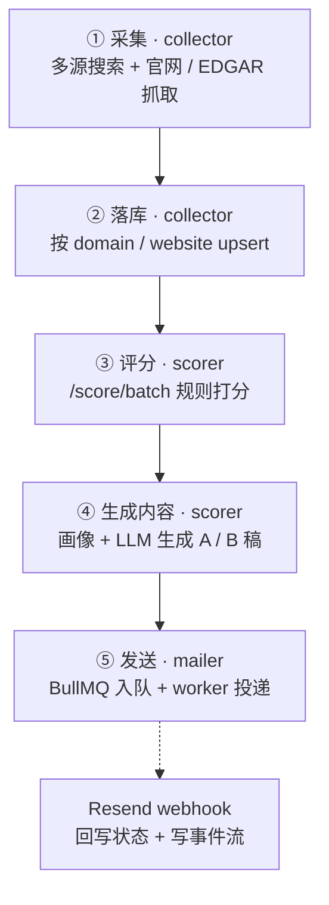
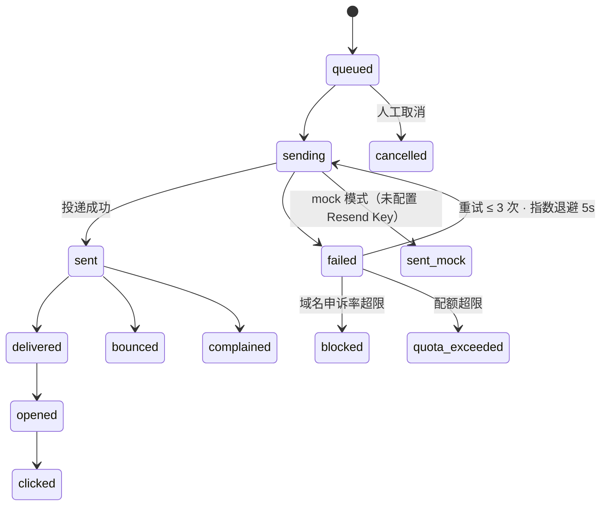

# 完整任务执行流程（采集 → 落库 → 评分 → 生成内容 → 发送）

> 本文描述一条线索从「采集潜在客户」到「发送邮件」的完整链路，覆盖数据流转、任务调度、失败重试、幂等去重、结果记录、部分成功处理，以及演示环境与生产环境的隔离方式。
> 依据仓库当前源码整理，不包含未实现的设计意图。源码索引见文末。

---

## 1. 总览

链路共 5 个阶段，前 4 个是**同步 HTTP 调用链**，只有第 5 阶段「发送」是**异步队列任务**。
整个链路**没有统一编排器，也没有定时任务**，每个阶段都由看板手动触发。

触发入口：看板 → `gateway /api/collectors/run` → `collector /collect`。
collector 内部串行执行：搜索 → enrich → 落库 → 末尾 fire-and-forget 调用 `scorer /score/batch`。

---

## 2. 数据如何流转

以 `companies` 为骨干表，全部数据靠 `tenant_id` 隔离，靠 `company_id` / `contact_id` 串联。

| 阶段 | 服务 | 主要输入 | 产出表 | 幂等键 |
|---|---|---|---|---|
| ① 采集 | collector | 关键词、国家、结果上限 | 内存候选（不落库） | 按 `domain` 去重 |
| ② 落库 | collector | 候选列表 | `companies`、`contacts` | `tenant_id + website` / `raw_payload->>'domain'`；`tenant_id + email` |
| ③ 评分 | scorer | `companies` | `lead_scores` | `tenant_id + company_id`（`overridden_by IS NULL`） |
| ④ 生成内容 | scorer | `companies` + 最新 `lead_scores` | `profiles`、`content_drafts` | `tenant_id + company_id`（画像 upsert） |
| ⑤ 发送 | mailer | `contacts` + `content_drafts` | `email_sends` | `jobId = email_send_id` |
| ⑤ 回调 | mailer | Resend webhook | `email_events` + 回写 `email_sends` | `resend_message_id` 匹配发送记录 |

关键点：

- `content_drafts.body` 会**快照**进 `email_sends.body_snapshot`，草稿后续被修改不影响已发送内容。
- 采集阶段给候选统一打 `raw_payload.demo = false`，与演示数据（`demo = true`）区分。
- 采集阶段的 enrich 优先抓官网正文；正文字数少于阈值（强 JS 渲染）时降级 Playwright；SEC 公司走 EDGAR 10-K 提取官网与公开邮箱。

---

## 3. 任务如何调度

### 同步链（阶段 ①②③④）

- 看板点击 → gateway 转发（鉴权/租户边界在 gateway）→ 目标微服务。
- collector 内部是**串行** for 循环：每个关键词搜索一次，每个候选落库一次。
- 打分由 collector 在落库结束后**同步触发** `POST /score/batch`，失败只记入 `errors[]`，不影响已落库数据。
- 内容生成按公司同步调 LLM（生成画像 → 生成 A/B 稿）。

### 异步队列（阶段 ⑤）

- `mailer /mails/single` 或 `/mails/enqueue`：先写 `email_sends`（`status = 'queued'`），再入 BullMQ 队列 `pcb-mailer-sends`。
- 常驻 worker（`concurrency = 1`）消费，逐个投递。
- 批量入队用 `delay = MIN_SEND_INTERVAL_MS × i` 控制发送间隔，避免瞬时并发。
- worker 必须常驻进程运行，不能跑在 Serverless。

### 当前没有的能力

- 没有定时/cron 调度，没有「一次点击跑完整条链路并自动发信」的编排。
- 代码注释中已标注：打分批量接口「P3 接入 BullMQ 改为异步队列」。

---

## 4. 失败如何重试

失败处理分四层，只有队列层是**自动重试**，其余靠「逐条容错 + 幂等键」保证可安全重跑。

| 层 | 位置 | 机制 | 关键参数 |
|---|---|---|---|
| L1 网络层 | collector | HttpClient 重试 + 熔断器 + 全局限速 | `retries=2`、`minInterval ≥ 2000ms` |
| L2 单条容错 | collector / scorer | 逐条 `try-catch`，错误只记入 `errors[]`，不中断后续 | 循环内独立捕获 |
| L3 队列层 | mailer | BullMQ 自动重试 + 指数退避 + `jobId` 幂等 | `attempts=3`、`backoff delay=5000ms` |
| L4 配额回滚 | mailer | 发送失败统一 `rollbackQuota` 一次（避免双重回滚把计数打成负数） | 进入 `try` 前 consume，`catch` 内统一回滚 |

### 发送任务状态机

说明：

- worker 只在 `status ∈ {queued, failed}` 时执行，其余状态直接 skip，因此**重新入队是安全的**。
- 域名被 suspend 时状态置 `blocked` 并抛错，需人工介入（Redis key 7 天后自动解除）。
- 硬退信（hard bounce）自动拉黑联系人；软退信累计到阈值（默认 3 次）也拉黑。
- 申诉率（complaint rate）超过阈值（默认 0.001）自动 suspend 出信域名。

---

## 5. 如何避免重复执行

| 环节 | 机制 |
|---|---|
| 采集 | 候选用 `Map` 按 `domain` 去重；同一关键词内不重复 |
| 落库 | 先按 `website` 查，再按 `raw_payload->>'domain'` 查，命中则 update（`enrichmentPatch` 只覆盖非空字段），未命中才 insert |
| 联系人 | `contacts` 有 `unique(tenant_id, email)`，插入用 `onConflictDoNothing` |
| 打分 | `lead_scores` 有部分唯一索引 `(tenant_id, company_id) WHERE overridden_by IS NULL`；批量打分前先查已存在则 `skipped` |
| 发送入队 | `jobId = email_send_id`，重复入队被 BullMQ 忽略 |
| 发送执行 | worker 校验状态，只处理 `queued` / `failed` |

### 已知缺口（如实标注）

- `email_events.resend_event_id` 只建了**普通索引，不是唯一索引**，webhook 重放时可能重复计数（open/click 次数偏高）。
- 生产上**没有「该联系人是否已发过」的去重**，同一联系人可能被创建多条 `email_sends`。若需严格防重，应在 `email_sends` 上加业务唯一约束或在入队前查已发送记录。

---

## 6. 如何记录每次处理结果

| 阶段 | 记录载体 | 关键字段 |
|---|---|---|
| 采集 | `runCollect` 返回值（不落库） | `searchHits` / `candidates` / `companiesCreated` / `companiesUpdated` / `contactsCreated` / `errors[]` / `durationMs` |
| 评分 | `lead_scores` 行（append-only，每次新增一行，不 in-place 更新） | `score` / `grade` / `finalGrade` / `dimensionBreakdown` / `evidence` / `modelVersion` |
| 内容 | `content_drafts` 行 | `status`（generated/approved/rejected/sent）/ `model` / `usedFacts` / `gaps` |
| 发送 | `email_sends` 行 + `email_events` 事件流 | `status` / `retryCount` / `lastError` / `sentAt` / `deliveredAt` / `openCount` / `clickCount` / `bounceType` |
| 人工操作 | `audit_logs` | `action` / `entityType` / `entityId` / `before` / `after` |

打分采用 append-only 设计的原因：保留模型版本演化轨迹，便于追踪「这条线索当初为什么是 A 级」。

---

## 7. 如何处理部分成功

整体策略：**逐条独立、整体不中断**。任一单条失败不会回滚已成功的数据。

- **采集**：每个关键词、每个候选单独 `try-catch`，错误累积到 `errors[]`，其余继续；`companiesCreated` 与 `companiesUpdated` 分开计数；`scored` 可为 `null`（未启用或无 `SCORER_URL`）。
- **批量打分**：返回 `{ processed, skipped, results[] }`，逐条标记 `status: created | skipped`。
- **批量入队**：返回 `{ total, enqueued, failed, results[{ itemIndex, emailSendId | error }] }`，逐条给出结果。
- **发送**：每个 job 独立重试，单个 job 失败不影响队列中其他任务。

因此「部分成功」的补救方式是**重跑该阶段**——由第 5 节的幂等键保证重跑不会产生脏数据。

---

## 8. 如何区分演示环境和生产环境

四道隔离：

| 隔离层 | 做法 |
|---|---|
| 数据库 | 两套库：`pcb_leadgen_demo` / `pcb_leadgen`。部署前**两套都要**执行 `drizzle-kit migrate`，否则代码里的新列会导致线上 500 |
| 数据标记 | 演示数据统一挂 `companies.raw_payload->>'demo' = 'true'`，`seed.ts` 按此标记精确回滚，不误伤真实数据；采集产物统一打 `demo = false` |
| 收件人 | 演示联系人邮箱由 `demoEmail()` 生成「你自己邮箱 + 别名」，即使误点「批准并发信」也只进自己收件箱 |
| 发送通道 | `RESEND_API_KEY` 缺失或为占位符时进入 mock 模式，`usedMock = true` → `status = 'sent_mock'`，不真实投递 |

补充：

- 租户用 `TENANT_ID` 环境变量区分；配置分 `.env`（本地）与 `.env.production`（生产）。
- 演示用小内存机器时，可在 env 下调 `COLLECTOR_EDGAR_CONCURRENCY` 与 `COLLECTOR_MAX_RESULTS_PER_KEYWORD`，正式上线再放大（配置值是硬上限，前端传更大值也会被夹到上限内）。
- 一键演示准备脚本 `demo.command`，会先 `seed.ts --purge-failed` 重置演示数据，再补齐服务并自检。

---

## 9. 当前边界与已知缺口

1. **无端到端编排**：链路由人工分阶段触发，不是「一次点击自动跑完并发送」。
2. **无定时调度**：没有 cron/定时任务，打分批量接口尚未队列化（注释标注 P3）。
3. **跨阶段失败不自动补偿**：如「落库成功但打分失败」，不会自动重试打分，需重跑该阶段（幂等保证安全）。
4. **webhook 事件未去重**：`resend_event_id` 非唯一，重放可能重复计数。
5. **无跨发送去重**：同一联系人可能被重复创建 `email_sends`。

---

## 10. 源码索引

| 关注点 | 文件 |
|---|---|
| 采集主流程 | `apps/collector/src/pipeline.ts` |
| 采集配置与合规下限 | `apps/collector/src/config.ts` |
| 落库 / 幂等 upsert | `apps/collector/src/store/persist.ts` |
| 打分路由（单条 / 批量 / 查最新） | `apps/scorer/src/routes/score.ts` |
| 打分模型 | `apps/scorer/src/scoring/index.ts` |
| 内容生成 / 画像 / 草稿审批 | `apps/scorer/src/routes/content.ts` |
| 发送入队 | `apps/mailer/src/routes/sends.ts` |
| 发送 worker（重试 / 配额 / 状态机） | `apps/mailer/src/workers/send-worker.ts` |
| 队列定义（attempts / backoff） | `apps/mailer/src/lib/queue.ts` |
| 配额 / 域名 suspend | `apps/mailer/src/lib/quota.ts` |
| Resend 客户端（mock 模式） | `apps/mailer/src/lib/resend-client.ts` |
| webhook 回调与拉黑 | `apps/mailer/src/routes/webhook.ts` |
| gateway 转发（租户边界） | `apps/gateway/src/routes/collectors.ts`、`apps/gateway/src/routes/mails.ts` |
| 表结构 | `packages/db/src/schema/*.ts` |
| 演示数据种子 | `scripts/demo/seed.ts` |
| 演示一键准备 | `demo.command` |
